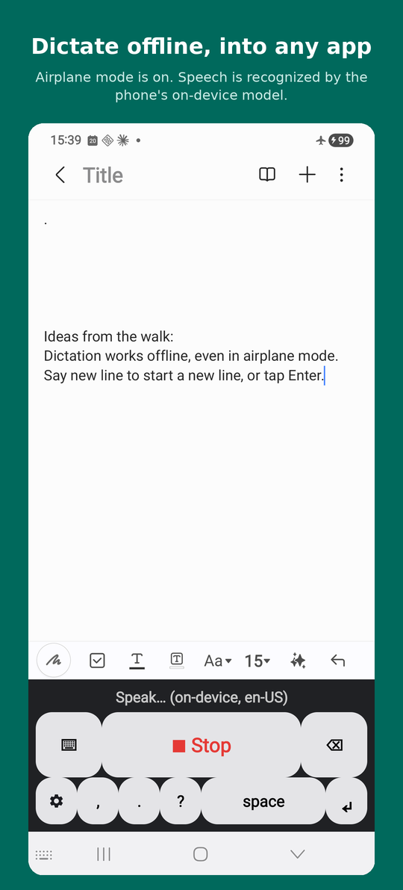
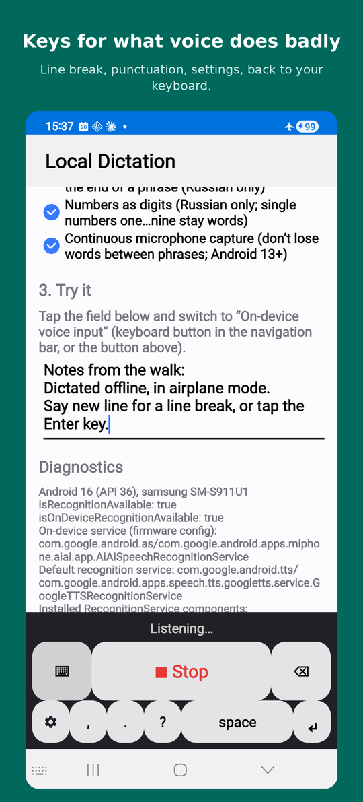
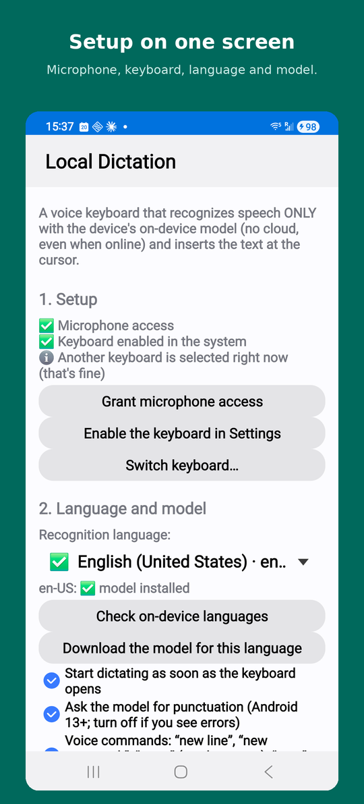

# Local Dictation

[](https://github.com/bsamsonov/mobile-local-dictation/actions/workflows/build.yml)
[](LICENSE)

An Android voice keyboard (IME) that recognizes speech **only on the device** and types the text at the
cursor in any app. No cloud, no network: it uses the on-device recognizer that ships with the phone
(`SpeechRecognizer.createOnDeviceSpeechRecognizer`, Android 12+).

Built and tested on a Samsung Galaxy S23 (Android 16), where the on-device engine is Google's
Android System Intelligence (SODA). Russian is the main use case; other languages work if the
on-device model for them is installed.

<p align="center">
  
  
  
</p>

## Why

I dictate notes on a Samsung phone, and the stock voice input kept getting in the way:

- **It tries to work online.** Samsung's default recognizer goes to the network, and on a weak or flaky connection it
  lags, drops words or fails, even though the phone already has a good on-device model. This keyboard uses only the
  on-device model, so a bad connection (or none) makes no difference.
- **No line breaks by voice.** There was no way to say "new line" and get one. Here "new line" / "new paragraph" /
  "enter" are voice commands, and there is a ↵ key.
- **Missing punctuation.** Some marks are hard to get by voice, so `,` `.` `?` are one tap away, next to the
  engine's own spoken punctuation.

## Features

- Dictation into any text field; partial results appear as composing text, final results are committed.
- Continuous dictation: after each pause the recognition session restarts automatically until you press Stop.
- Continuous microphone capture (Android 13+, experimental, off by default): the app records the mic itself and feeds
  the audio to the engine (`EXTRA_AUDIO_SOURCE`) with a short replay buffer. On Google's engine it makes every session end
  with an error before the final result, so phrase endings get cut off ([#8](https://github.com/bsamsonov/mobile-local-dictation/issues/8)).
- Recovery from a stalled or busy recognizer (watchdog, recreate + back-off).
- Keys for what voice does badly: line break, punctuation, settings, back to your regular keyboard (see [Keys](#keys)).
- Punctuation by voice ("comma", "period") is done by the engine itself (formatting, Android 13+).
- Voice commands "new line" / "enter" / "new paragraph" (English and Russian) insert line breaks.
- Russian post-processing (`TextPost`): numbers as digits,
  "stop" (said in Russian) at the end of a phrase stops dictation.
- Settings screen: microphone permission, enabling the IME, a language drop-down showing which on-device
  models are installed (default English; your pick is kept), model download, diagnostics of which
  recognition service the firmware uses. Changes are saved at once (a short "Saved" confirms it); Done or the
  up arrow closes the screen.
- A stop is remembered: after you tap Stop, locking and unlocking the phone does not turn the mic back on;
  switching to this keyboard from another one starts dictation again.
- UI in English and Russian (per-app language on Android 13+).

## Works offline

The app has no `INTERNET` permission. Recognition runs on the phone's built-in Google on-device model
(Android System Intelligence), so in airplane mode you still get:

| Offline | Needs network |
|---|---|
| Speech recognition (installed language model) | Downloading a language model, once (done by the system; may wait for Wi-Fi or charging) |
| Spoken punctuation (engine formatting, Android 13+) | |
| "new line" / "new paragraph" / "stop" commands, digits | |
| All keyboard keys, settings, diagnostics | |

Languages the engine offers only online are not used: the app never falls back to cloud recognition.

## Keys

| Key | Action |
|---|---|
| 🎤 Dictate / ■ Stop | Start continuous dictation / stop it |
| ⌨ | Stop dictation and return to the previous (regular) keyboard; long press opens the keyboard picker |
| ⚙ | Stop dictation and open the settings screen |
| ↵ | Line break (sends Enter to the field) |
| `,` `.` `?` | Insert the punctuation mark at the cursor |
| space, ⌫ | Space and backspace |

## Limitations

- Depends on the firmware: the device must provide an on-device recognition service and a model for your language.
  Samsung's own engine is not available to third-party apps.
- The engine ends a session on every pause and does not support segmented sessions, so the app restarts sessions;
  words said in the short gap between sessions may be lost.
- Digit conversion and the "stop" command are implemented for Russian only.

## Install

Download `local-dictation-0.2.0.apk` from [Releases](https://github.com/bsamsonov/mobile-local-dictation/releases/latest)
and open it on the phone (allow installing from your browser or file manager when asked). Requires Android 12+.
The APK is signed with the project's own key, not a Google Play key; updates from Releases install over it.
To build it yourself, see [Build](#build).

## Build

No Gradle: `build.sh` uses the SDK tools directly (aapt2, javac, d8, apksigner).

Requirements: JDK 17+, Android SDK with `platforms;android-35` and `build-tools;35.0.0`
(`ANDROID_HOME` or `~/Android/Sdk`; override the build-tools version with `BUILD_TOOLS_VERSION`).

```bash
./build.sh test       # TextPost unit tests (plain JDK)
./build.sh            # -> build/local-dictation.apk (signed with a generated debug key)
./build.sh install    # build + adb install -r
```

## Setup on the phone

1. Install the APK and open **Local Dictation**.
2. Grant microphone access.
3. Enable the keyboard ("On-device voice input") in system settings.
4. Check on-device languages; download the model for your language if it is not installed.
5. In any text field switch to "On-device voice input" (on Samsung: Settings → General management →
   Keyboard list and default → "Keyboard button on navigation bar"). The ⌨ key returns to the previous
   keyboard; long press opens the keyboard picker.

## Code

| File | Role |
|---|---|
| `DictationIME.java` | The keyboard: recognizer lifecycle, auto-restart, watchdog, text insertion |
| `AudioFeeder.java` | Continuous mic capture with a ring buffer, fed to the engine through a pipe |
| `MainActivity.java` | Settings, permissions, model check/download, diagnostics |
| `Speech.java` | Preferences and the `RecognizerIntent` |
| `TextPost.java` | Russian post-processing (pure Java, tested in `test/`) |

## Specification

Behavior is specified with [OpenSpec](https://github.com/Fission-AI/OpenSpec) in [`openspec/`](openspec/):
[`project.md`](openspec/project.md) (principles, success criteria), current specs in
[`openspec/specs/`](openspec/specs/) (dictation, keyboard keys, settings, text post-processing) and planned work in
[`openspec/changes/`](openspec/changes/) (model download prompt, English terms in Russian speech; done changes are in `openspec/changes/archive/`).

```bash
npx @fission-ai/openspec validate --all
```

## Troubleshooting

Logs: `adb logcat -v time LocalDictation:D SodaSpeechRecognizer:I AndroidRuntime:E '*:S'`
(the app logs only events and text lengths, never the recognized text).
If the recognition service hangs: `adb shell am force-stop com.google.android.as`.

## License

MIT
